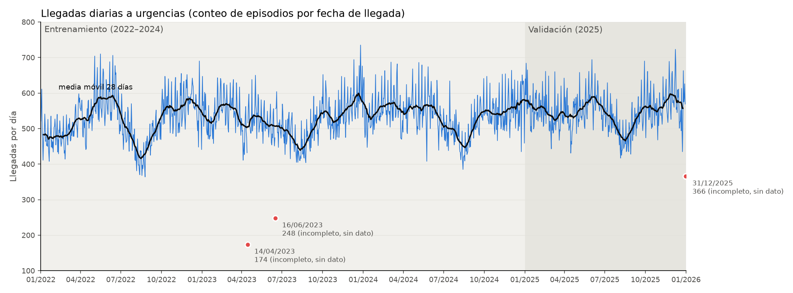

# TFG · Fase 1: construcción de la base de datos entrenable

Fecha: 04/11/2026 · Actualizado el 11/11/2026 con la revisión de la tutora (`Silvia/20261111-Revisión SJF.md`) · Versión editable (del 04/11/2026): [documento en Claude](https://claude.ai/artifact/JT7AE7TU8PNLBws2Cmt87Z)

## Introducción

La Fase 1 está terminada: a partir de los datos crudos del hospital se ha construido una serie diaria continua de **1.461 días** (2022–2025), con variables de calendario y meteorología, normalizada y dividida cronológicamente en entrenamiento, validación y test.

El TFG, *Predicción de la demanda diaria de urgencias hospitalarias mediante modelos de aprendizaje automático* (alumna: Paula Fernández Sánchez; tutora: Silvia Jiménez Fernández; cotutor: Alberto Palomo Alonso), busca predecir las llegadas diarias a urgencias con 1 a 7 días de antelación. Este documento explica, paso a paso, qué se ha hecho en la Fase 1 y por qué.

Reglas de trabajo seguidas:

- **El anteproyecto es el esqueleto**: se pueden hacer cosas que no aparecen en él si tienen un motivo (una pregunta concreta), siguen un orden lógico y quedan documentadas. No se añade nada «por si acaso».
- **Separar fuentes oficiales de criterio propio**, y dejar escrita cada decisión.
- **Los datos de pacientes nunca se suben a GitHub.**

## Datos de partida

Se trabaja con los ficheros entregados por el hospital (la tutora está buscando datos de 2026). Son volcados de phpMyAdmin (sentencias `INSERT INTO`) que se leen con Python sin instalar una base de datos.

| Fichero | Qué contiene | Tamaño |
| --- | --- | --- |
| `episodios (2022–2025).sql` | Un episodio de urgencias por fila: llegada, salida, edad, servicio, triaje, alta… | 778.472 episodios |
| `codificacion (2022–2025).sql` | Códigos CIE-10 de cada episodio | 3.816.119 filas |
| `prd_unificado.sql` | Predicciones del sistema actual del hospital, una fila por día (sep-2024 a may-2026) | 537 días |

Por indicación de la tutora, **el número real de llegadas se obtiene contando los episodios por su fecha de llegada** (`fecha_inicio`). Las predicciones de `prd_unificado.sql` no son llegadas reales: se usarán en la Fase 2 para comparar con el sistema actual.

## Paso 1 · Ingesta y curación del dato crudo

Se unen los 4 años de episodios y de codificación, se revisan duplicados y errores, y se unifica el formato de cada campo. Los registros con problemas **se marcan, no se borran**. Script: `tfg/fase1_paso1_ingesta.py`.

1. **Duplicados.** No hay episodios repetidos ni códigos repetidos. Había un caso con el mismo episodio y orden pero códigos distintos: no es un duplicado y se conserva (al principio el script lo borraba por error; se corrigió).
2. **Marcas de calidad.** Cada problema se señala con una columna `flag_*` (unos 6,4 % de los episodios tienen alguna). **Todos estos episodios se cuentan como llegadas**: son personas que llegaron a urgencias, aunque no se sepa si se fueron sin triaje o si no se guardó el resultado. Las marcas solo documentan la calidad del dato.

| Marca | Episodios | Qué significa |
| --- | --- | --- |
| `flag_sin_diagnostico` | 42.850 | Sin diagnóstico principal codificado |
| `flag_sin_triaje` | 6.112 | Sin nivel de triaje |
| `flag_triaje_incoherente` | 1.143 | Triaje antes de la llegada o después de la salida |
| `flag_estancia_larga` | 1.064 | Más de 72 h en urgencias |
| `flag_fuera_periodo` | 60 | Llegada fuera de 2022–2025 |
| `flag_edad_invalida` | 1 | Fecha de nacimiento imposible (01/01/1800); edad vacía |
| `flag_fin_antes_inicio` | 0 | Salida anterior a la llegada |

3. **Homogeneización de campos.**
   - Tipos: fechas como fechas y números como números; los vacíos (`NULL`, `""`, espacios) se unifican, y las fechas imposibles (`1900-01-00`, 344 casos) quedan vacías.
   - `nivel_triaje`: de 1 (crítico) a 5 (no urgente). Había más de 10 formas de escribirlo; si falta, se deduce de la columna `gravedad`.
   - `es_ingreso`: sí cuando `motivo_alta` es «HOSPITALIZACION U».
   - `dx_capitulo`: capítulo CIE-10 del diagnóstico principal (22 grupos).
   - `duracion_min`: minutos en urgencias (salida − llegada).
4. **Edad.** Es la que tenía el paciente **el día de esa llegada**, en años cumplidos (número entero), calculada con la fecha de nacimiento y la de llegada. Un mismo paciente tiene, por tanto, edades distintas en cada episodio: por ejemplo, 15 años en septiembre de 2022, 16 en noviembre de 2022 y 19 en octubre de 2025. El fichero traía una edad decimal redondeada (a quien le faltaba un día para cumplir 16 le salía 16,00); al corregirlo, 30 episodios pasaron a Pediatría.
5. **Área asistencial** (`area`):
   - **PED** si el paciente tiene menos de 16 años ese día.
   - Si no, **GIN** si el servicio es Urgencias Ginecológicas, Urgencias Obstétricas u Obstetricia.
   - El resto, **GEN**.

   La edad tiene prioridad sobre el servicio: una paciente de menos de 16 años atendida en Ginecología u Obstetricia cuenta como PED. Este corte queda fijado para este trabajo, sin consultarlo al hospital.
6. **Columnas descartadas:** `fuente`, `resp_final`, `resp_ing` y `fecha_ing` (vacías), `resp_acl` y `resp_alta` (identifican al profesional), `tipo_acto` (siempre «URGENCIAS») y `f_nacimiento` (dato personal, solo se usa para calcular la edad).

Resultado: 778.472 episodios limpios (157.165 PED, 58.704 GIN y 562.603 GEN) y el informe `informes/fase1_paso1_calidad.md`.

## Paso 2 · Serie diaria y particiones

Se cuentan los episodios de cada día por su fecha de llegada, en total y por área, y cada día se asigna a una partición cronológica. Script: `tfg/fase1_paso2_serie_diaria.py`.

- **Columnas:** `llegadas` (lo que se va a predecir), `llegadas_PED`, `llegadas_GIN` y `llegadas_GEN` (suman `llegadas`), `salidas` (solo como referencia) y `particion`.
- **Calendario completo:** los 1.461 días del 01/01/2022 al 31/12/2025, sin huecos, incluso si un día no tuviera episodios.

### División del conjunto de datos

La división es siempre **cronológica** (entrenamiento, después validación y por último test, sin mezclar días) y con **años completos**, para que la validación recorra todas las estaciones una vez. Entre entrenamiento y validación, como máximo un 30 % para validación. Se elige con el parámetro `DIVISION` del paso 2, sin tocar el resto del código.

| División | Entrenamiento | Validación | Test |
| --- | --- | --- | --- |
| **A** (la preferida, la que está puesta) | 2022–2024 · 1.096 días (75 %) | 2025 · 365 días (25 %) | 2026, cuando lleguen los datos |
| **B** (si no llegan datos de 2026) | 2022–2023 · 730 días (67 %) | 2024 · 366 días (33 %) | 2025 · 365 días |

En la B la validación pasa un poco del 30 %; se acepta para mantener años completos (con un corte exacto 70/30 la validación empezaría el 07/02/2024 y no recorrería un año entero).

Con la división A, sin contar los días en blanco:

| Partición | Periodo | Días con dato | Llegadas/día (media) | Mínimo | Máximo |
| --- | --- | --- | --- | --- | --- |
| Entrenamiento | 2022–2024 | 1.094 | 528,5 | 364 | 735 |
| Validación | 2025 | 364 | 547,9 | 417 | 723 |

El modelo aprende con entrenamiento, la configuración se elige en validación y test se usa **una sola vez**, al final. Sobre el test se puede comparar también con el sistema actual del hospital.

### Días incompletos: dato faltante, sin imputación

Al revisar las salidas por hora aparecieron 3 días con registros perdidos: se dejó de registrar información a mitad del día, así que su número de llegadas **no es un dato real**.

| Día | Partición (división A) | Llegadas registradas | Problema |
| --- | --- | --- | --- |
| 14/04/2023 | Entrenamiento | 174 | Casi no hay salidas en todo el día (90 de unas 500) |
| 16/06/2023 | Entrenamiento | 248 | Ninguna salida de 14:00 a 23:59 |
| 31/12/2025 | Validación | 366 | Faltan los pacientes que salieron en 2026 (no hay fichero de 2026) |

Se tratan como **valores faltantes** (*missing values*, `NaN`), **sin imputación**:

- Los 3 días se quedan en la serie, que mantiene los 1.461 días sin huecos, como pide el anteproyecto.
- `llegadas`, `llegadas_PED`, `llegadas_GIN`, `llegadas_GEN` y `salidas` van **en blanco**. No se rellenan con ningún valor estimado (ni el día anterior, ni la semana anterior, ni el año anterior, ni medias): sería meter ruido inventado.
- Las variables de calendario y de meteorología de esos días sí están rellenas, porque son correctas.



Llegadas por día de 2022 a 2025, con la media móvil de 28 días en negro. La línea se corta en los 3 días incompletos; en rojo, lo que se llegó a registrar esos días, que no se usa.

Cómo los gestionan los modelos en la Fase 2:

- Al **entrenar**, esos días no se usan como objetivo, y al **evaluar** no se puntúan: no hay valor real.
- Si un día en blanco hace falta como entrada (por ejemplo, el «día anterior»), esa entrada queda en blanco. SARIMAX (filtro de Kalman) y XGBoost lo admiten; en los modelos que no, se descarta esa muestra y se indica cuántas se han descartado.

Al principio esos días se borraban y la serie tenía 1.458 días; se cambió en la revisión del 11/11/2026.

## Paso 7 · Variables exógenas

A cada día se le añaden variables de calendario y de meteorología, todas de fuentes oficiales o públicas y alineadas día a día con la serie. Script: `tfg/fase1_paso7_variables_exogenas.py`.

| Variable | Qué indica | Fuente |
| --- | --- | --- |
| `anio`, `mes`, `dia_mes`, `dia_anio`, `semana_anio` | Posición del día en el calendario | Calendario |
| `dia_semana`, `fin_de_semana` | Día de la semana (0 = lunes … 6 = domingo); 1 si es sábado o domingo | Calendario |
| `festivo`, `nombre_festivo` | 1 si es festivo nacional o de la Comunidad de Madrid (48 días en 2022–2025) | Decretos de fiestas laborales de la Comunidad de Madrid (BOCM); comprobados con la librería `holidays` |
| `vacaciones_escolares`, `tipo_vacaciones`, `dia_lectivo` | Navidad, Semana Santa o verano escolar; 1 si hay colegio | Calendarios escolares de la Comunidad de Madrid (Infantil y Primaria), cursos 2021-22 a 2025-26; el 2025-26 por la Orden 1476/2025 (BOCM 13/05/2025) |
| `temp_max`, `temp_min`, `temp_media` | Temperatura del día (°C) | Open-Meteo, reanálisis ERA5, punto más cercano al hospital (zona de Majadahonda) |
| `precipitacion` | Lluvia del día (mm) | Open-Meteo |
| `humedad` | Humedad relativa media (%) | Open-Meteo |

No se incluyen las fiestas locales, porque los pacientes vienen de muchos municipios distintos. También se quitaron variables de criterio propio sin una pregunta detrás (puentes, vísperas, post-festivos, Nochebuena y Nochevieja, calor extremo) y pruebas estadísticas de relevancia. **La relevancia de las exógenas se estudiará en la Fase 2**, comparando en validación el mismo modelo con y sin ellas, por grupos (sin exógenas, + calendario, + meteorología, + las dos) y en cada horizonte.

**Cuidado con la meteorología.** Es la **observada** de cada día (reanálisis), no una previsión. Como se predice al final del día *t* para los días *t+1 … t+7*, solo se puede usar como entrada la meteorología **hasta el día *t***; usar la de los días que se predicen sería usar información que no se conoce en ese momento, y los resultados saldrían mejores que en la realidad. El calendario de los días que se predicen sí se puede usar, porque se conoce de antemano. Para usar previsiones del tiempo harían falta previsiones históricas reales de 2022–2025 (pendiente de ver si hay una fuente fiable).

## Paso 8 · Normalización

Las variables continuas se normalizan con **min-max**, con el mínimo y el máximo calculados **solo con el entrenamiento** de la división elegida (división A: 2022–2024). Los días en blanco no cuentan para el mínimo ni el máximo, y siguen en blanco después de normalizar. Script: `tfg/fase1_paso8_normalizacion.py`.

```
valor normalizado = (valor − mínimo de entrenamiento) / (máximo de entrenamiento − mínimo de entrenamiento)
```

Por qué se normaliza: las variables tienen escalas muy distintas (unas 500 llegadas, unos 20 °C, de 0 a 80 mm de lluvia), y muchos modelos aprenden peor si unas pesan más solo por tener números más grandes.

| Variable | Mínimo | Máximo |
| --- | --- | --- |
| Llegadas | 364 | 735 |
| Llegadas PED | 37 | 213 |
| Llegadas GIN | 16 | 68 |
| Llegadas GEN | 280 | 542 |
| Temperatura máxima (°C) | 5,5 | 40,6 |
| Temperatura mínima (°C) | −5,5 | 25,6 |
| Temperatura media (°C) | 0,6 | 33,3 |
| Precipitación (mm) | 0 | 77,5 |
| Humedad (%) | 17 | 98 |

Ejemplo, 01/01/2022: (521 − 364) / (735 − 364) = **0,423**.

- **Sin fuga de datos:** validación y test no intervienen en el cálculo del mínimo y el máximo. Sí se les aplica la misma fórmula con esos valores, para que el modelo reciba los datos en la escala con la que aprendió. Por eso algún día de validación (2025) queda un poco fuera de 0–1 (por ejemplo, Pediatría −0,125, Ginecología 1,058 o temperatura máxima −0,043).
- **Variables cíclicas** (`dia_semana`, `mes`, `dia_anio`): se pasan a seno y coseno, con periodos 7, 12 y 365,25, para que el domingo quede junto al lunes y diciembre junto a enero.
- **Variables binarias** (`fin_de_semana`, `festivo`, `vacaciones_escolares`, `dia_lectivo`): se dejan como 0/1.
- Los parámetros se guardan para deshacer la normalización de las predicciones y volver a pacientes por día.

Al principio se usó la estandarización, (x − media) / desviación; se cambió a min-max por indicación de Paula.

## Entregables y dónde están

El código está en GitHub; los datos de pacientes y los Excel solo en el equipo de Paula.

| Entregable | Dónde | Contenido |
| --- | --- | --- |
| Código | [GitHub · TFG-P](https://github.com/lramostriguero-coder/TFG-P), rama `main` | Scripts de los pasos 1, 2, 7 y 8, informe de calidad, gráfica de la serie y `CONTEXTO_TFG.md` |
| Datos procesados | `datos/procesados/` (no se sube) | `episodios_limpios.parquet`, `serie_diaria.csv`, `dataset_fase1.csv`, `dataset_fase1_normalizado.csv`, `parametros_normalizacion.csv` |
| Excel de episodios | `C:\PAULA\UNI\TFG\Datos_urgencias\FASE1` | `episodios_limpios_2022` a `2025`.xlsx: episodios limpios con edad en años cumplidos y marcas de calidad |
| Excel de la serie | Misma carpeta | `datos_urgencias_fase1.xlsx`: unificación de campos, errores detectados, serie diaria y resumen |
| Excel de variables | Misma carpeta | `variables_exogenas_y_normalizadas_fase1.xlsx`: leyenda, variables exógenas, parámetros y normalización con fórmulas `MIN`/`MAX` visibles |

**Los Excel están pendientes de actualizar** a la revisión del 11/11/2026: todavía tienen 1.458 días y la división antigua (entrenamiento 2022–2023). Hasta esa revisión coincidían con Python (diferencias menores de 0,0001 por redondeo) y no tenían errores de fórmula. Hay copias de seguridad de los Excel anteriores en `FASE1\copia_antes_eliminar_incompletos` y `FASE1\copia_antes_edad_entera`.

Para repetir todo el proceso (Python 3.12):

```
pip install -r requirements.txt
python tfg/fase1_paso1_ingesta.py --origen "C:/PAULA/UNI/TFG/Datos_urgencias"
python tfg/fase1_paso2_serie_diaria.py
python tfg/fase1_paso7_variables_exogenas.py
python tfg/fase1_paso8_normalizacion.py
```

## Decisiones tomadas y siguientes pasos

| Decisión | Quién la tomó | Por qué |
| --- | --- | --- |
| Las llegadas se cuentan por `fecha_inicio` | Tutora | Es el número real de pacientes que llegan cada día |
| Los registros con problemas se marcan, no se borran | Criterio del trabajo | No perder información y poder decidir después qué hacer con ellos |
| Los episodios con marcas de calidad se cuentan como llegadas | Tutora | Son personas que llegaron a urgencias |
| Los 3 días incompletos quedan en blanco (`NaN`), sin imputación | Tutora | Su número de llegadas no es real; rellenarlos sería inventar datos, y borrarlos dejaría huecos en el calendario |
| División cronológica por años completos, A (test 2026) o B (test 2025) | Tutora | La validación recorre todas las estaciones; el test se usa una sola vez |
| Menos de 16 años → PED, también en Ginecología u Obstetricia | Tutora | Corte fijado para este trabajo |
| Meteorología solo hasta el día en que se predice | Tutora | No usar información que no se conoce al hacer la predicción |
| Edad en años cumplidos el día de cada llegada | Paula | El estudio debe usar la edad real del paciente en cada episodio |
| Normalización min-max con mínimo y máximo de entrenamiento | Paula | El anteproyecto pide normalizar sin fijar el método; el mínimo y el máximo de entrenamiento evitan la fuga de datos |
| Fuera del anteproyecto, solo lo que tenga un motivo, un orden lógico y quede documentado | Tutora | El anteproyecto es el esqueleto; no se añade nada «por si acaso» |

Siguientes pasos:

- [ ] Actualizar los Excel de la Fase 1 a 1.461 días con los 3 días en blanco y la división A.
- [ ] Explicar en la memoria los 3 días en blanco y por qué no se imputan.
- [ ] Fase 2 · Baselines: persistencia (mañana = hoy) y naïve estacional semanal (mismo día de la semana anterior).
- [ ] Fase 2 · ARIMA → SARIMA → SARIMAX, con el estudio de qué días anteriores usar.
- [ ] Fase 2 · Estudio de relevancia de las exógenas (con y sin ellas), empezando en SARIMAX.
- [ ] Fase 2 · Ensembles de árboles (árbol de decisión, XGBoost) y redes neuronales (tradicionales y Transformers).
- [ ] Fase 2 · Predicción de 1 a 7 días con incertidumbre, desglosada por áreas, comparada con el sistema actual del hospital, y una interfaz para probar los modelos.
