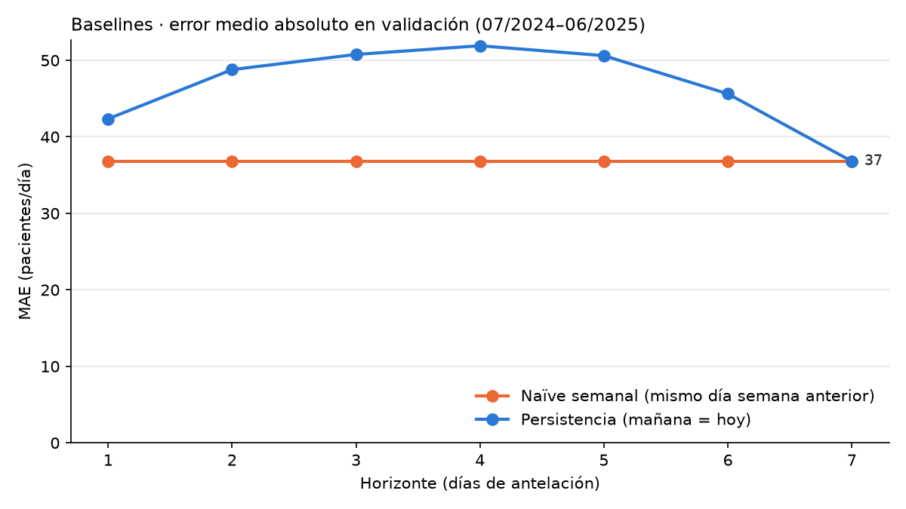

# Fase 2 · Paso 1 — Baselines

Script: `tfg/fase2_paso1_baselines.py` · Experimento 1 · Evaluado en **validación (01/07/2024–30/06/2025, 365 días)**.

## Pregunta

¿Qué error comete una predicción que no aprende nada? Es la nota mínima: cualquier modelo de la Fase 2 tiene que bajar de aquí para que merezca la pena.

## Cómo se predice

Al final del día *t* se predicen los días *t+1 … t+7* (horizonte *h*), solo con las llegadas conocidas hasta *t*.

| Baseline | Fórmula | Idea |
|---|---|---|
| Persistencia | ŷ(t+h) = y(t) | «Mañana = hoy»: se repite el último día conocido |
| Naïve estacional semanal | ŷ(t+h) = y(t+h−7) | «Mismo día de la semana anterior». Como h ≤ 7, ese día ya se conoce |

Con h = 7 los dos coinciden, porque t+7−7 = t.

**Ejemplo con números reales.** Día objetivo 01/07/2024 (lunes), 556 llegadas reales:

- h = 1 (se predice el domingo 30/06): persistencia = 505 (el domingo) → error 51; naïve semanal = 537 (lunes 24/06) → error 19.
- h = 7 (se predice el lunes 24/06): los dos dan 537 → error 19.

## Métricas (sobre las llegadas reales, sin normalizar)

- **MAE**: error medio en pacientes/día. Es la principal porque se entiende directamente.
- **RMSE**: castiga más los fallos grandes.
- **MAPE**: error en % de las llegadas del día.

Criterio propio: el anteproyecto no fija las métricas; se usan estas tres por ser las habituales en predicción de demanda. Las mismas para todos los modelos.

## Resultados

| h | Persistencia MAE | RMSE | MAPE | Naïve semanal MAE | RMSE | MAPE |
|---|---|---|---|---|---|---|
| 1 | 42,4 | 55,2 | 7,8 % | **36,8** | **47,4** | **6,9 %** |
| 2 | 48,8 | 62,9 | 9,0 % | **36,8** | **47,4** | **6,9 %** |
| 3 | 50,8 | 64,3 | 9,4 % | **36,8** | **47,4** | **6,9 %** |
| 4 | 51,9 | 66,0 | 9,5 % | **36,8** | **47,4** | **6,9 %** |
| 5 | 50,6 | 63,8 | 9,3 % | **36,8** | **47,4** | **6,9 %** |
| 6 | 45,6 | 58,7 | 8,4 % | **36,8** | **47,4** | **6,9 %** |
| 7 | 36,8 | 47,4 | 6,9 % | 36,8 | 47,4 | 6,9 % |

Días en blanco: ninguno afecta a la validación (365 días puntuados en todos los horizontes, 0 descartados).

## Incertidumbre: intervalo de predicción del 90 %

**Pregunta:** ¿entre qué valores caerán las llegadas reales?

**Método (empírico):** con los errores (real − predicción) del **entrenamiento** se toman los percentiles 5 y 95. El intervalo de cada día es [predicción + P5 ; predicción + P95]. En validación se mira la **cobertura**: el % de días con el valor real dentro del intervalo, que debería rondar el 90 %. También se mira la **anchura**: cuanto más estrecho, más útil.

**Ejemplo:** el naïve semanal predice 537 para el 01/07/2024. Con P5 = −74 y P95 = +71, el intervalo es [463 ; 608]. El valor real, 556, cae dentro.

| Total | P5 | P95 | Anchura | Cobertura en validación |
|---|---|---|---|---|
| Persistencia h = 1 | −85,8 | +81,0 | 167 | 86,3 % |
| Persistencia h = 4 | −110,0 | +108,0 | 218 | 89,0 % |
| **Naïve semanal (h = 1…7)** | **−74,0** | **+71,0** | **145** | **90,4 %** |

La cobertura ronda el 90 % en todos los casos: los errores de validación se parecen a los del entrenamiento. El naïve semanal tiene además el intervalo más estrecho, unos ±72 pacientes. Todos los horizontes están en `fase2_paso1_baselines.csv`.

## Desglose por áreas

Mismo cálculo con las llegadas de cada área. Persistencia: MAE de h = 1 a h = 7.

| Área | Llegadas/día (validación) | Persistencia MAE | **Naïve semanal MAE** | RMSE | MAPE | Intervalo 90 % | Cobertura |
|---|---|---|---|---|---|---|---|
| PED | ~100 | 17,1 – 24,5 | **14,4** | 19,0 | 16,7 % | [−34 ; +32] | 92,6 % |
| GIN | ~44 | 10,0 – 11,1 | **8,3** | 10,5 | 20,2 % | [−15 ; +15] | 86,0 % |
| GEN | ~395 | 35,6 – 41,0 | **28,5** | 37,8 | 7,2 % | [−57 ; +55] | 90,4 % |

- También por áreas, el naïve semanal gana a la persistencia en todos los horizontes.
- En % el error es mucho mayor en PED (17 %) y GIN (20 %) que en GEN (7 %). Con pocos pacientes al día, el azar pesa más.
- GIN cubre algo menos del 90 % (86 %). En validación hubo días más alejados de lo habitual que en el entrenamiento.

## Excel

`C:\PAULA\UNI\TFG\Datos_urgencias\FASE2\baselines_fase2.xlsx`, generado con `tfg/fase2_paso1_excel.py`. Tiene las fórmulas visibles y estas hojas:

- **Leyenda:** qué hay en cada hoja.
- **Metricas:** MAE, RMSE, MAPE, P5, P95, anchura y cobertura.
- **Total:** las 8 predicciones con su error, |error|, error² y |error|/real.
- **Areas:** el naïve semanal de PED, GIN y GEN, con las mismas columnas.

Coincide con Python y no tiene errores de fórmula. No se sube a GitHub porque contiene las llegadas diarias.

## Conclusión

- **El naïve semanal es el mejor baseline en todos los horizontes**: unos 37 pacientes/día de error (6,9 %).
- Su error es **el mismo en los 7 horizontes**, porque siempre usa el mismo dato: el mismo día de la semana anterior, sin importar desde cuándo se predice.
- La persistencia empeora hacia h = 3–5 y mejora en h = 6–7. Es la huella del **ciclo semanal**: a 7 días de distancia se cae en el mismo día de la semana, y a 3–4 días en el más distinto (p. ej. de un lunes a un jueves).
- Por eso **el día de la semana es lo que más explica las llegadas**, y es lo primero que tendrá que captar ARIMA (con el término estacional de SARIMA, s = 7).
- **Nota a batir (total): MAE ≈ 36,8 pacientes/día en todos los horizontes, con un intervalo del 90 % de ±72 pacientes (cobertura 90,4 %).** Por áreas: PED 14,4, GIN 8,3 y GEN 28,5.
